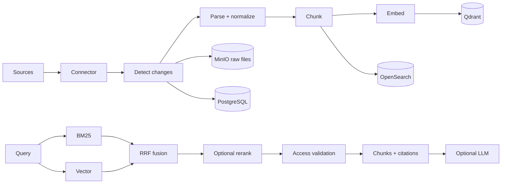

# ContextForge

Document ingestion, hybrid retrieval and evaluation for internal knowledge search.

ContextForge ingests PDF, DOCX, Markdown, HTML and text files, keeps every version, indexes them
for BM25 and vector search, enforces document-level permissions, and measures retrieval quality.
An LLM assistant is an optional consumer of the search results; nothing in ingestion, search or
evaluation needs one.

> Status: all code was written without access to the Docker services, so the full stack has not
> been run end to end. See [Tested and not tested](#tested-and-not-tested).

## Problem

Employees search thousands of documents using words that differ from the documents' own wording
("how long do we keep debugging output" vs. "debug logs are kept for 7 days"). Keyword search alone
misses these; vector search alone misses exact identifiers such as `ERR-4021`. Documents also
change, disappear and have different audiences. The platform therefore has to keep indexes in step
with the source, combine both retrieval styles, and never return a chunk the user is not allowed
to read.

## Architecture



More diagrams and component descriptions: [docs/architecture.md](docs/architecture.md).

## Ingestion workflow

Scan, hash, compare with stored hashes, then for new or changed files: archive raw bytes in MinIO,
parse, normalize, chunk, embed, write to both indexes, verify counts, and only then switch the
document to the new version and remove old chunks. Unchanged files are skipped; removed files are
deleted from both indexes. Failures are recorded on the document and retried on the next run.
Details and lifecycle: [docs/ingestion-pipeline.md](docs/ingestion-pipeline.md).

## Hybrid retrieval

BM25 (OpenSearch) and dense search (Qdrant) each return a candidate list. Reciprocal Rank Fusion
combines them using ranks only: `score = sum(weight / (k + rank))`, `k = 60` by default. An optional
cross-encoder reranks the top candidates. Finally each hit is validated against PostgreSQL for
access and version. Design notes: [docs/retrieval-design.md](docs/retrieval-design.md).

## Technology decisions

PostgreSQL holds metadata and permissions (system of record); MinIO archives raw files so documents
can be re-indexed without the source; Qdrant and OpenSearch are rebuildable indexes;
`all-MiniLM-L6-v2` is a small local embedding model that needs no API key. Rationale and
trade-offs: [docs/engineering-decisions.md](docs/engineering-decisions.md).

## Installation

Requires Python 3.12+. Docker is only needed for the full stack.

```bash
python -m venv .venv
source .venv/bin/activate            # Windows PowerShell: .venv\Scripts\Activate.ps1
pip install --extra-index-url https://download.pytorch.org/whl/cpu torch
pip install -e ".[dashboard,dev]"
cp .env.example .env                 # Windows: Copy-Item .env.example .env
```

The first run with `EMBEDDING_BACKEND=sentence-transformers` downloads about 90 MB
(embedding model); using `--rerank` downloads about 90 MB more (cross-encoder). Models are cached
under `~/.cache/huggingface` (or the `modelcache` Docker volume). The CPU-only torch wheel is
roughly 200 MB; the default PyPI wheel is much larger. Allow several GB of disk for the Docker
images (OpenSearch, Qdrant, MinIO, PostgreSQL, the app image).

## Quick start without Docker

Runs the whole pipeline in memory (nothing persists):

```bash
contextforge search "how long are audit logs kept" --local --user alice
contextforge evaluate --local
```

For a run without any model download add `EMBEDDING_BACKEND=hashing` (PowerShell:
`$env:EMBEDDING_BACKEND="hashing"`). The hashing embedder is not semantic; do not judge vector
search with it.

## Docker Compose setup

```bash
docker compose up -d --build        # postgres, minio, qdrant, opensearch, api, dashboard
docker compose ps                   # wait until services report healthy
curl http://localhost:8000/health
```

| Service | URL |
|---|---|
| API and OpenAPI docs | http://localhost:8000/docs |
| Dashboard | http://localhost:8501 |
| MinIO console | http://localhost:9001 |
| Qdrant | http://localhost:6333/dashboard |
| OpenSearch | http://localhost:9200 |

Airflow is optional: `docker compose --profile airflow up -d --build`, UI at
http://localhost:8080 (`airflow standalone` prints a generated admin password in
`docker compose logs airflow`). Enable the `contextforge_ingestion` DAG; trigger it with
`{"force": true}` to re-index everything.

OpenSearch needs `vm.max_map_count >= 262144` on Linux hosts
(`sudo sysctl -w vm.max_map_count=262144`); Docker Desktop on Windows normally handles this.

## Sample document ingestion

The sample corpus in `datasets/sample_documents/` has 16 fictional documents in five formats, in
folders that map to access rules (`config/access_policies.yaml`).

With the stack from Docker Compose running, ingest from the host (the `.env` file points the CLI at
localhost) or through the API:

```bash
contextforge init
contextforge ingest
# or
curl -X POST http://localhost:8000/documents/ingest -H "X-API-Key: cf-dev-alice" \
     -H "Content-Type: application/json" -d '{}'
```

Run it again to see incremental behaviour: the second run reports every document as skipped.
Edit a file under `datasets/sample_documents/` and re-run to produce version 2; delete a file and
re-run to remove it from search. PowerShell users should use `curl.exe` or `Invoke-RestMethod`.

## Search examples

```bash
contextforge search "what does ERR-4021 mean" --user bob
contextforge search "how do I revert a bad gateway deployment" --mode vector --user bob
contextforge search '"rate limit" gateway' --mode bm25 --user bob       # quoted = exact phrase
contextforge search "salary range for band E3" --user erin               # no results: restricted
contextforge search "salary range for band E3" --user alice --rerank
```

## API usage

Authenticate with `X-API-Key`. Development keys (fictional): `cf-dev-alice` (administrator),
`cf-dev-bob` (engineering), `cf-dev-carol` (product), `cf-dev-dave` (operations), `cf-dev-erin`
(general employee), `cf-dev-frank` (administrator of a different tenant).

```bash
curl -s http://localhost:8000/search -H "X-API-Key: cf-dev-bob" -H "Content-Type: application/json" \
  -d '{"query": "how many requests per minute per key", "mode": "hybrid", "top_k": 3, "rerank": false}'

curl -s http://localhost:8000/chat -H "X-API-Key: cf-dev-erin" -H "Content-Type: application/json" \
  -d '{"question": "How many days per week can I work remotely?"}'

curl -s "http://localhost:8000/documents?limit=10&offset=0" -H "X-API-Key: cf-dev-carol"
```

| Endpoint | Access | Purpose |
|---|---|---|
| `GET /health` | open | dependency checks |
| `GET /metrics` | open | Prometheus-format counters and latency summaries |
| `POST /documents/ingest` | admin | scan `SOURCE_ROOT` (or a sub-directory) |
| `GET /documents`, `GET /documents/{id}` | user, ACL-filtered | list (paginated) and details with versions |
| `POST /documents/{id}/reindex` | admin | rebuild from the archived raw file |
| `DELETE /documents/{id}` | admin | remove from indexes (the source file is untouched; the next ingestion re-adds it unless the file is removed) |
| `POST /search` | user | `bm25`, `vector` or `hybrid`; optional `rerank`, `document_version` |
| `POST /chat` | user | grounded answer or cited excerpts |
| `GET /evaluation/results` | user | latest evaluation report |
| `GET /stats`, `GET /me` | admin / user | dashboard counters, identity |

Interactive documentation: `/docs`.

### Optional LLM

Set `LLM_BASE_URL` and `LLM_MODEL` in `.env`, for example `http://localhost:11434/v1` and
`llama3.1` for Ollama (from inside Docker use `http://host.docker.internal:11434/v1`). Any
OpenAI-compatible endpoint works; add `LLM_API_KEY` if it needs one. Without these, `/chat` returns
the best excerpt of each retrieved chunk with citations. If the model says the context is
insufficient, or the LLM call fails, the response says so instead of inventing an answer.

## Dashboard

Open http://localhost:8501 (or `make dashboard` locally), enter an API key in the sidebar.
Tabs: Overview (counts and recent runs; administrators), Documents (status, versions, errors,
re-index), Search playground (mode, Top-K, scores and signals, side-by-side comparison of all four
methods), Evaluation (metric tables and latency charts from the latest report).

## Evaluation methodology

28 fixed queries, keyword-derived relevance, Recall@K / Precision@K / Hit Rate@K / MRR / latency,
for BM25, vector, hybrid and hybrid + rerank:

```bash
contextforge evaluate                 # Docker services, after `contextforge ingest`
contextforge evaluate --local         # in memory
```

Reports are written to `reports/evaluation/latest.{json,md}`. No results are included in the
repository because they depend on your embedding model and hardware. Read
[docs/evaluation.md](docs/evaluation.md) for definitions and limitations before drawing
conclusions.

## Testing

```bash
make test                                   # unit + local-backend integration tests
pytest tests/unit                           # fast, no external services
pytest tests/integration/test_ingestion_flow.py -k "modified or deleted or interrupted"
pytest tests/integration/test_access_enforcement.py
pytest tests/integration/test_evaluation.py
make up && make test-integration            # Qdrant and OpenSearch adapter tests
ruff check . && ruff format --check .
```

Tests that parse PDFs skip automatically if PyMuPDF is missing. Local-backend tests use the hashing
embedder and a word-overlap stand-in for the cross-encoder, so they need no model downloads.

## Known limitations

- Single process, no job queue: `POST /documents/ingest` runs synchronously.
- No locking between concurrent ingestion runs outside Airflow.
- No OCR; scanned PDFs are recorded as `empty`.
- Only a filesystem connector; hashing reads every file on every scan.
- Heading detection in PDFs uses font size and fails on documents with uniform fonts.
- Document ACLs are listed per request in Python before pagination, which does not scale to
  very large tenants.
- English-only analyzer and embedding model by default.
- Local authentication only; see [docs/access-control.md](docs/access-control.md).
- Evaluation set is small and keyword-judged.

## Future improvements

S3, SharePoint and Google Drive connectors; OCR for scanned PDFs; OIDC authentication; background
ingestion with a queue; index aliasing for zero-downtime embedding-model changes; LLM-assisted
answer evaluation, kept separate from the deterministic metrics; larger labelled evaluation set.

## License

MIT.
