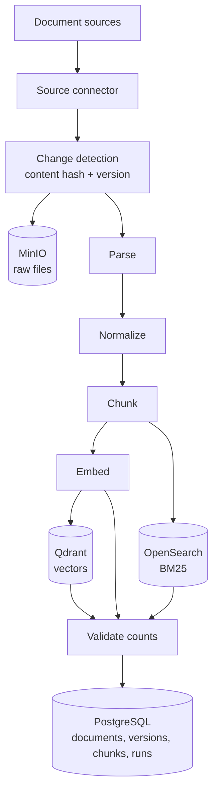
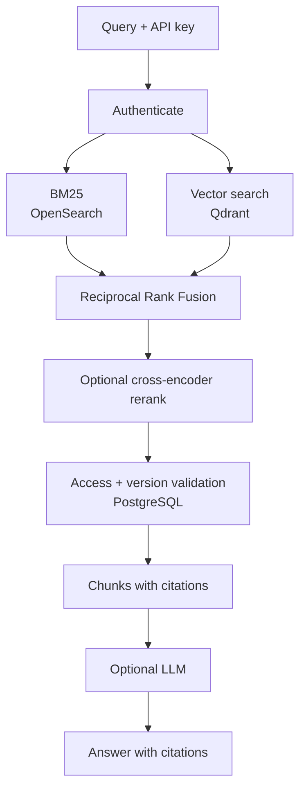

# Architecture

ContextForge has two workflows that share one metadata store: an offline indexing pipeline and an
online retrieval path.

## Components

| Package | Responsibility |
|---|---|
| `connectors` | Enumerate source files with a content hash (`FilesystemConnector`); interface for new sources |
| `parsing` | PDF, DOCX, HTML, Markdown, TXT to sections with titles and page numbers |
| `normalization` | Unicode and whitespace clean-up, header/footer and page-number removal for PDFs |
| `chunking` | Fixed-size and structure-aware chunkers with identical metadata |
| `embeddings` | Sentence Transformers backend and a deterministic hashing fallback |
| `indexing` | Qdrant and OpenSearch adapters, plus in-memory implementations of the same interfaces |
| `ingestion` | Incremental pipeline; staged work items for Airflow |
| `retrieval`, `reranking` | Hybrid retriever, RRF, cross-encoder reranker |
| `access_control` | Users, roles, ACL rules, policy file, API-key directory |
| `evaluation` | Metrics, runner, report writer |
| `assistant` | Retrieval-grounded answers, OpenAI-compatible LLM client |
| `api` | FastAPI application |
| `orchestration` | Stage functions called by the Airflow DAG |
| `storage` | SQLAlchemy models, repository, MinIO and local object stores |

## Two interchangeable backends

`BACKEND=services` uses PostgreSQL, MinIO, Qdrant and OpenSearch. `BACKEND=local` uses in-memory
SQLite, a temporary directory and in-memory indexes that implement the same interfaces. The local
backend exists so the pipeline logic, access control and evaluation can be tested without
containers. It does not persist anything.

## Where state lives

- PostgreSQL is the system of record: documents, versions, chunk text, ACLs, run history.
- Qdrant and OpenSearch are derived indexes. They can be rebuilt from PostgreSQL and MinIO.
- MinIO keeps the exact bytes of every ingested version, which makes `reindex` independent of the
  original source.
