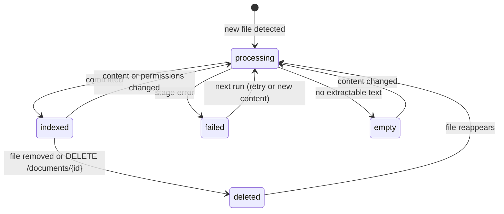

# Ingestion pipeline

## Stages

`scan -> detect -> extract -> normalize -> chunk -> embed -> index (vector, keyword) -> validate -> commit`

Each stage is a method on `IngestionPipeline`. A stage does nothing for an item that already
failed, so the same methods run in-process (`contextforge ingest`) or one per Airflow task.

## Change detection

A document id is derived from `(tenant, source, relative path)`, so a path keeps its identity
across edits. Each scan hashes file content with SHA-256 and compares it with the stored hash:

| Situation | Action | Version |
|---|---|---|
| Path never seen | `new` | 1 |
| Hash differs | `modified` | +1 |
| Hash same, previous attempt failed or was interrupted | `retry` | same |
| Hash same, permissions in the policy file changed | `acl_update` | same |
| Hash same, nothing else changed | skipped | - |
| Path missing from the source | deleted | - |
| Previously deleted path reappears | `restored` | +1 |
| `--force` | `reindex` | same |

Deletion detection only considers documents under the scanned prefix, and a scan that returns zero
files while documents are indexed is refused unless `force` is set. This protects against an
unmounted source directory wiping the index.

## Version switch

`documents.current_version` is the newest version seen. `documents.indexed_version` is the newest
version fully present in both indexes. Search only returns chunks whose version equals
`indexed_version`.

1. Chunks of the new version are upserted into Qdrant and OpenSearch (ids derive from the chunk
   id, so repeating the step overwrites).
2. Counts in both indexes are compared with the expected chunk count.
3. Only then are older versions deleted from both indexes, chunk rows swapped in PostgreSQL, and
   `indexed_version` advanced.

If anything fails before step 3 the previous version keeps being served, the document is marked
`failed` with the error, and the next run retries it. This is covered by
`test_interrupted_indexing_keeps_serving_old_version_then_recovers`.

## What is and is not guaranteed

Re-running ingestion is idempotent: chunk ids are deterministic and indexes upsert, so repeated
runs do not create duplicate chunks or embeddings (tested with repeated and forced runs). It is
not exactly-once processing. A crash can cause a document to be embedded twice. The result is the
same, only the work is repeated.

Two ingestion runs against the same documents at the same time are not coordinated. The Airflow DAG
sets `max_active_runs=1`; the CLI and API do not lock.

## Failure handling

Parsing errors, unreadable files and index errors are stored on the document and on the version
row as JSON (`stage`, `type`, `message`, `detail`). Nothing is skipped silently. A file with no
extractable text, such as a scanned PDF, gets status `empty` with a message; OCR is not
implemented. Changed-while-reading files are detected by re-hashing the bytes that were parsed.

## Document lifecycle



## Running without Airflow

```bash
contextforge ingest                 # whole SOURCE_ROOT
contextforge ingest --path datasets/sample_documents/policies
contextforge ingest --force         # rebuild every document
```

## Airflow

`dags/contextforge_ingestion.py` chains nine tasks (`scan_sources`, `extract_documents`,
`normalize_documents`, `chunk_documents`, `embed_documents`, `update_vector_index`,
`update_keyword_index`, `validate_and_commit`, `record_metrics`) with 2 retries and per-task
timeouts. Work items pass between tasks through `STAGING_DIR`. Tasks run in a separate virtualenv
because the Airflow image pins SQLAlchemy 1.4. The DAG has not been run in this repository's
development environment.
